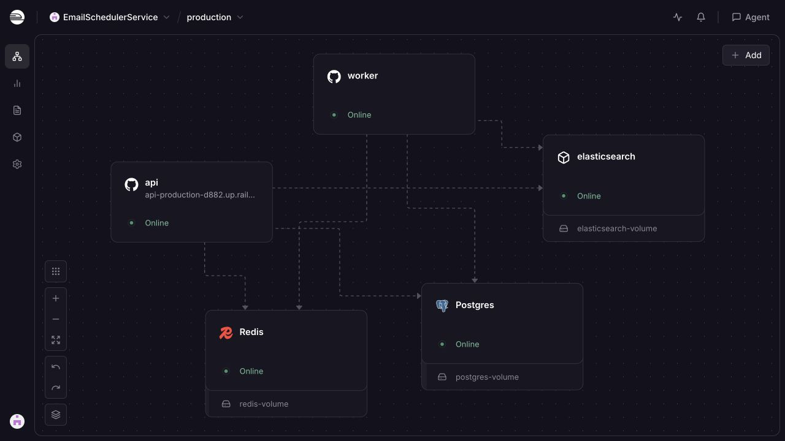

# Email Scheduler Service

A small email scheduling app built with Express and TypeScript, React, PostgreSQL, Redis, BullMQ, and Elasticsearch. It follows the [ReachInbox assignment](https://sumptuous-word-80f.notion.site/Software-Development-Intern-Assignment-2bc1596f45e88080995cec1180a2bc60) and the supplied [Figma design](https://www.figma.com/design/kOTwGlESjijCYnMgtHfvfU/Outbox-Labs-Assignment?node-id=59-4050).

## Demo and current status

**Open the app:** https://api-production-d882.up.railway.app/

Choose **Create an account** on your first visit, then use your email and password to log in. Passwords must contain at least 12 characters. No Google setup is needed for direct login.

- [API health](https://api-production-d882.up.railway.app/health/live) checks whether the API is running.
- [Dependency health](https://api-production-d882.up.railway.app/health/ready) checks PostgreSQL, Redis, Elasticsearch, and the worker heartbeat.
- [Railway project](https://railway.com/project/6e662898-d5d2-402e-acf2-d44c7e927953) shows the deployment; access requires permission to the Railway workspace.

The app, direct login, and dependency connections have been verified. **End-to-end SMTP sending is currently blocked by Railway Hobby's outbound SMTP restriction.** Railway requires Pro or above for SMTP; after upgrading, redeploy the worker. See [Railway's email delivery rules](https://docs.railway.com/networking/outbound-networking). Google login and Slack notifications require their OAuth app credentials in the API service. A green readiness check confirms infrastructure connectivity; use `/health/oauth` to check the Google OAuth configuration separately.

## Architecture on Railway

The entire running setup is hosted on Railway. PostgreSQL, Redis, Elasticsearch, and BullMQ workers are not run locally.



| Component | What it does |
| --- | --- |
| API service | Runs Express, handles login and scheduling requests, and serves the built React frontend. |
| Worker service | Runs BullMQ email jobs and maintenance jobs. Connects to Ethereal and Slack when configured. |
| PostgreSQL | Stores users, senders, campaigns, email status, and pending notifications. |
| Redis | Stores delayed BullMQ jobs, shared rate counters, and login sessions. Uses persistent storage. |
| Elasticsearch | Makes scheduled and sent emails searchable by recipient, subject, and body. |

Both app services connect to the three data services over Railway's private network. Only the API has a public HTTPS domain. **BullMQ is a library inside the worker, not a separate database or managed service.**

## Run the backend and frontend

### 1. Get and check the code

You need access to this private repository, Node.js 22 or newer, npm, and a Railway account.

```sh
git clone https://github.com/vermavaibhav23/EmailSchedulerService.git
cd EmailSchedulerService
npm ci
npm run build
npm test
```

These commands install dependencies, build both apps, and run unit tests. They do not start local databases or workers.

### 2. Create the Railway infrastructure

Create a Railway project and add **PostgreSQL**, **Redis**, and **Elasticsearch** with persistent volumes. Use the step-by-step commands and image settings in [docs/RAILWAY.md](docs/RAILWAY.md), including the Redis persistence options and Elasticsearch volume permissions.

Name the database services `Postgres`, `Redis`, and `elasticsearch` to use the variable references below. Keep them private.

### 3. Deploy the API and worker

Add two services from this GitHub repository. Both use the repository root and its **Dockerfile**.

| Railway setting | API | Worker |
| --- | --- | --- |
| Pre-deploy command | `npm run migrate` | `npm run migrate` |
| Start command | `npm start` | `npm run worker` |
| HTTP health check | `/health/live` | None; the worker does not serve HTTP |
| Public domain | Generate a domain, target port `3000` | None |

Enter the environment variables below, deploy both services, then set `APP_URL` to the API's generated HTTPS URL. Set `PORT=3000` on the API. Keep serverless sleeping disabled so scheduled work can run continuously.

The Dockerfile runs `npm run build`, which builds Express and React. `npm start` serves both the backend and `frontend/dist` from one domain. **There is no separate frontend service to start on Railway.** To build only the frontend, use `npm run build -w frontend`.

Set these commands in Railway's service settings. The included `railway.toml` files are reference configurations; new services in this workspace use the settings UI.

### 4. Set environment variables

Use [.env.example](.env.example) as the variable-name checklist. Enter real values in Railway, never in Git.

| Variable | Value or purpose |
| --- | --- |
| `DATABASE_URL` | `${{Postgres.DATABASE_URL}}` |
| `REDIS_URL` | `${{Redis.REDIS_URL}}` |
| `ELASTICSEARCH_URL` | `http://elasticsearch.railway.internal:9200` |
| `ELASTICSEARCH_PASSWORD` | `${{elasticsearch.ELASTIC_PASSWORD}}` |
| `APP_URL` | Your API's public HTTPS URL, without a trailing slash |
| `SESSION_SECRET` | A random secret of at least 32 characters |
| `ENCRYPTION_KEY` | A random 32-byte key written as 64 hexadecimal characters |
| `WORKER_CONCURRENCY` | `5` by default |
| `MIN_SEND_DELAY_MS` | `2000`: at least two seconds between attempts for each sender |
| `MAX_EMAILS_PER_HOUR_PER_SENDER` | `200` by default |
| `MAX_CAMPAIGN_RECIPIENTS` | `10000` by default |
| `ADMIN_EMAILS` | Comma-separated, verified Google login emails allowed to view Bull Board |
| `GOOGLE_CLIENT_ID`, `GOOGLE_CLIENT_SECRET` | Needed for Google login; direct login works without them |
| `SLACK_CLIENT_ID`, `SLACK_CLIENT_SECRET` | Needed for Slack connection and notifications |

Set the shared database URLs and encryption key on both API and worker. OAuth credentials are needed by the API. Docker sets `NODE_ENV=production` automatically.

Run `openssl rand -hex 32` twice to generate separate values for `SESSION_SECRET` and `ENCRYPTION_KEY`. Keep the encryption key stable: changing it makes existing SMTP credentials and Slack webhooks unreadable.

## Set up Ethereal, Google, and Slack

### Ethereal test email

1. Make sure the Railway plan allows outbound SMTP, then redeploy the worker if the plan changed.
2. Log in and open **Compose New Email**.
3. Choose **Add Ethereal sender**. The backend creates a test SMTP account and stores its credentials encrypted. No SMTP password needs to be entered in the frontend or `.env`.
4. Choose that sender, enter a subject and body, and upload a CSV/text file of recipient addresses.
5. Set a future start time, send delay, and hourly limit, then choose **Schedule**.
6. Open a successfully sent email to view its Ethereal preview.

Ethereal is a test inbox. **It captures messages instead of delivering them to Gmail or any other recipient inbox.** See [Ethereal's explanation](https://ethereal.email/).

### Google login

Create a Google OAuth web application, add `GOOGLE_CLIENT_ID` and `GOOGLE_CLIENT_SECRET` to the API service, and register this exact redirect URI for the current demo:

```text
https://api-production-d882.up.railway.app/auth/google/callback
```

Start from **Login with Google** in the app. Opening the callback URL directly does not start a login. For your own deployment, replace the domain with your `APP_URL`.

After deploying, open `/health/oauth`. Both `clientIdConfigured` and
`clientSecretConfigured` must be `true`, and `redirectUri` must exactly match the
authorized redirect URI in Google Cloud. This endpoint reports only whether the
variables exist; it never returns either secret.

Compose shows the authenticated user's name and email in **From**. The selected
Ethereal account remains the SMTP delivery account and envelope sender.

### Slack notifications

Create a Slack app with the `incoming-webhook` OAuth scope. Set its client ID and secret on the API and register:

```text
https://api-production-d882.up.railway.app/integrations/slack/callback
```

Use **Connect Slack** in the dashboard and select a channel. The backend stores the webhook encrypted. A sender reaching its hourly limit creates a notification, delivered on the next maintenance cycle, normally within five seconds plus network time. Without a Slack connection, sending continues without notifications. Disconnect removes the connection; reconnect enables new notifications without a redeploy.

## How scheduling and recovery work

1. The API saves the campaign and every recipient in one PostgreSQL transaction.
2. Every five seconds, a BullMQ maintenance job finds saved emails that still need queueing and adds delayed jobs to Redis. There are no cron jobs or cron expressions.
3. Each email uses its database UUID as its queue job ID. Repeated queue insertion uses the same ID. Repeated API requests with the same user-scoped `Idempotency-Key` return the same campaign; different content with that key is rejected.
4. At the due time, a worker checks the sender's shared limits and claims the email in PostgreSQL before contacting SMTP.
5. SMTP acceptance records `sent` and an Ethereal preview. Explicit rejection records `failed`. An ambiguous network failure records `uncertain` and is not automatically resent.

PostgreSQL and Redis retain data on their Railway volumes. After a normal restart, BullMQ resumes future jobs; it does not rebuild the schedule from the beginning. Maintenance also recovers saved emails whose queue insertion was interrupted. A worker interrupted during SMTP leaves a `sending` row; after five minutes it becomes `uncertain`, rather than risking a duplicate.

### Concurrency, limits, and 1000+ emails

The default worker concurrency is **5**, configurable through `WORKER_CONCURRENCY`. Multiple workers share an atomic Redis counter for each sender and UTC hour; limits do not depend on process memory.

Each sender waits at least **2 seconds between send attempts**. The actual delay is the larger of the configured minimum and campaign delay. The hourly cap is the smallest of the service, sender, and campaign limits. Attempts, including failures, count toward the cap.

When the cap is reached, remaining jobs move to the next UTC hour. They are not dropped or permanently failed because of the limit. A large batch stays in the queue and is processed in bounded batches; different senders can make progress in parallel. Ordering is approximate when campaigns share a sender.

## Features mapped to the assignment

| Area | Implemented features |
| --- | --- |
| Backend: scheduler | Batch scheduling API, multiple senders, BullMQ delayed jobs, no cron. |
| Backend: persistence | PostgreSQL records, persistent Redis, recovery of pending jobs, duplicate-submission protection. |
| Backend: rate limiting | Shared per-sender UTC-hour counters, configurable cap, deferred overflow, minimum send delay. |
| Backend: concurrency | Configurable worker concurrency and database claims shared across worker instances. |
| Backend: search and visibility | Elasticsearch indexing and user-scoped search; read-only Bull Board at `/admin/queues` for verified, allowlisted admins. |
| Backend: Slack | Real OAuth connection, encrypted webhook, limit notifications, disconnect/reconnect. Credentials and live verification remain pending. |
| Frontend: login | Direct email registration/login, logout, name/email, avatar or initials, and Google OAuth with verified-email account linking. |
| Frontend: dashboard | Scheduled and Sent views, search, pagination, details, five-second refresh, loading/error/empty states. |
| Frontend: compose | Subject/body, CSV/text parsing and address count, duplicate removal, sender selection, start time, delay, hourly cap. |

## Testing and a short demo

Local verification: `npm test` and `npm run build` pass. Four unit tests cover password hashing, scheduling 1000 timestamps, input validation, and secret encryption. Live direct-login checks cover registration, login, logout, bad passwords, duplicate accounts, and request protection.

After SMTP and OAuth setup, follow [docs/VERIFICATION.md](docs/VERIFICATION.md) for live delivery, restart, rate-limit, search, and Slack checks. Those checks are not yet all completed on the current deployment.

For the required video, keep the recording under five minutes:

1. Log in, connect Slack, and create an Ethereal sender.
2. Schedule three test emails with a two-second delay and hourly limit of two.
3. Show Scheduled and Sent, successful Ethereal previews, and the Slack limit notification. Show the third job deferred to the next hour.
4. Schedule another email in the future. Stop the worker before it is due, restart it, and show the email processing without restarting the whole campaign or resending completed emails.

A demo video has not been recorded yet. The live endpoint above is available for interactive testing.

## Assumptions and trade-offs

- Exactly-once SMTP delivery cannot be guaranteed after an ambiguous network failure. Inspect Ethereal before creating a replacement for an `uncertain` email.
- The current Sent view also includes failed/uncertain attempts. Its date falls back to the scheduled time when no sent time exists; that fallback is not delivery confirmation.
- Complete Redis data loss can be recovered for pending email jobs, but the current hour's rate budget cannot be reconstructed. Persistent Redis storage and backups are required.
- Search updates asynchronously and can lag briefly. Search results are capped at 10,000 matches; ordinary lists remain available if Elasticsearch is down.
- Slack notifications can duplicate if the worker stops after Slack accepts one but before the database records it.
- Email/password accounts have no email verification or password recovery yet. They are separate from Google accounts and cannot gain admin access by claiming an allowlisted email.
- The composer sends plain text. Times are stored in UTC and displayed in the viewer's timezone.
